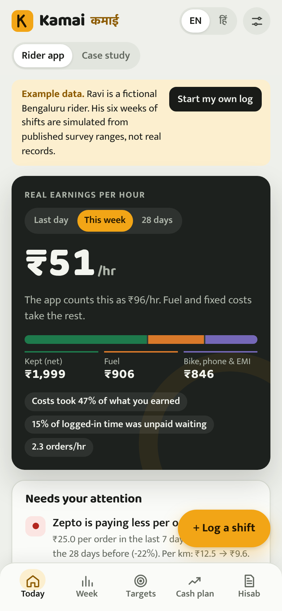
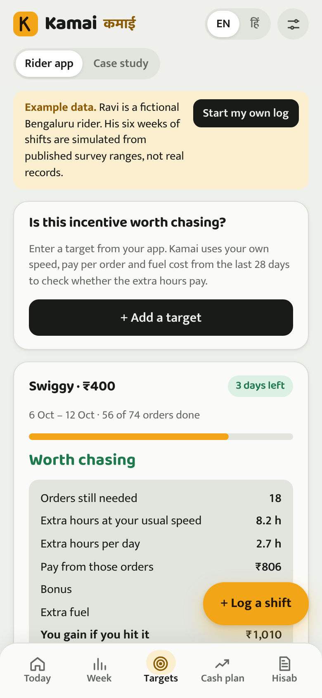
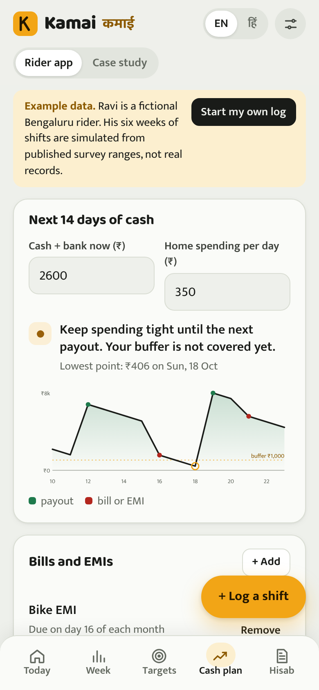
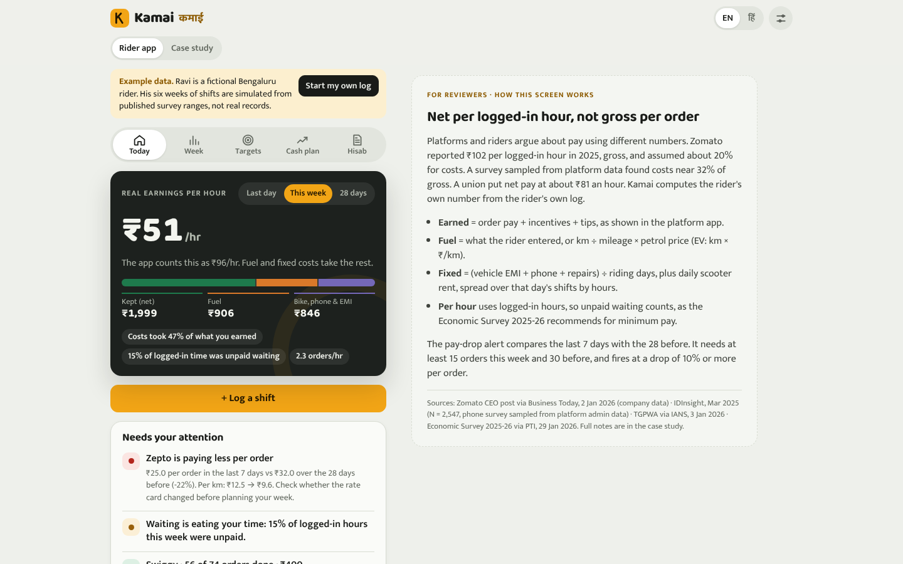
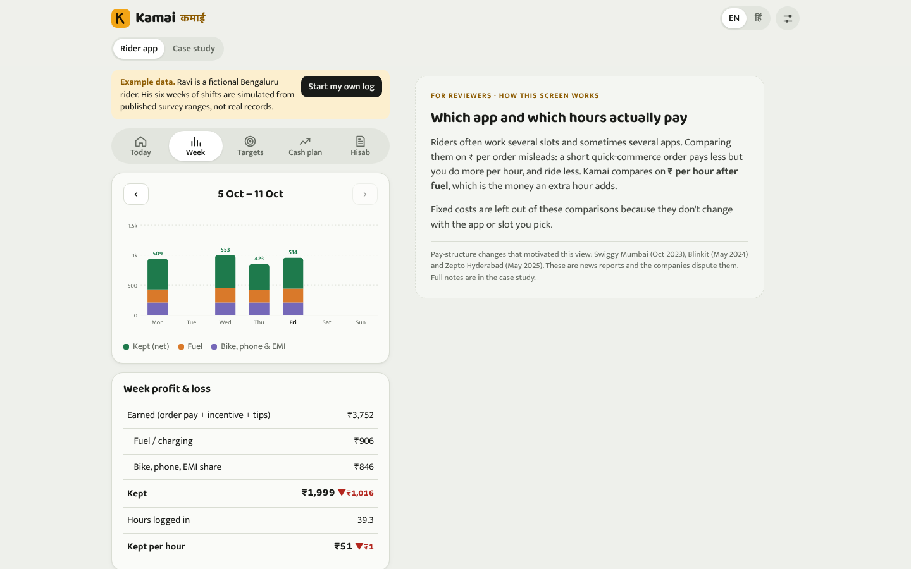
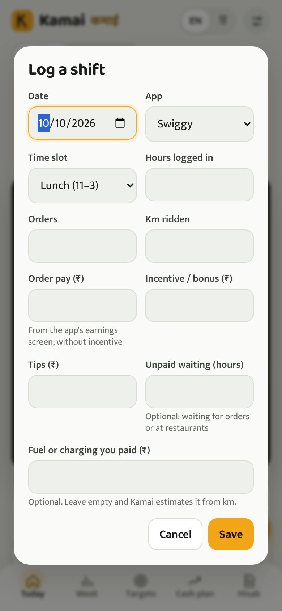
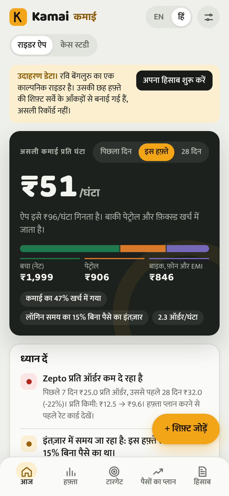
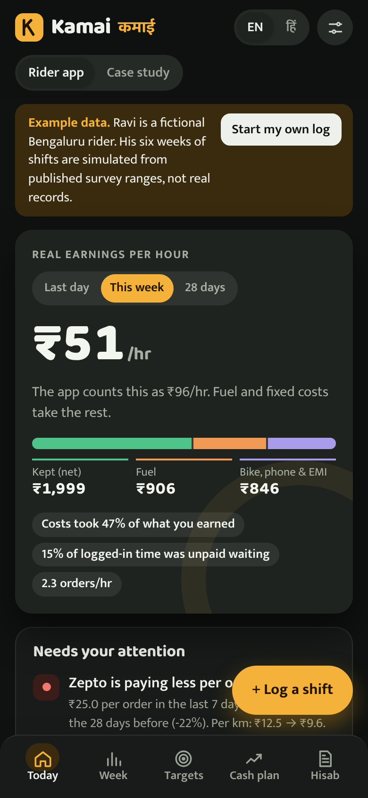
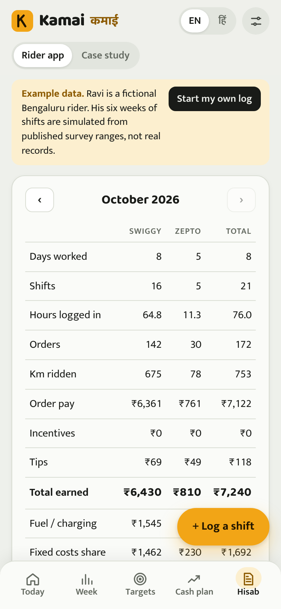

# Kamai (कमाई)

Kamai shows Indian food and quick-commerce delivery riders what they really keep per hour after fuel, bike, phone and EMI costs, counting the unpaid time spent waiting for orders.

A rider logs a shift in about six fields. Kamai turns those logs into real earnings per logged-in hour, a pay-cut alert for each app, a verdict on whether an incentive target is worth the extra hours, a 14-day cash plan, and a monthly statement the rider owns. It works in English and Hindi, needs no account, and keeps every number on the rider's phone.

Portfolio project by Nandini Kshatriya, built while preparing for Associate Product Manager roles.

- **Live demo:** see the link in the repository description (hosted as a static page)
- **Product case study:** [`docs/case-study.md`](docs/case-study.md), also inside the app under *Case study*
- **Research notes:** [`research/kamai_secondary_research.md`](research/kamai_secondary_research.md)

  

## Why it exists

Platforms, unions and researchers all publish a different "earnings per hour" for delivery riders.

- Zomato reported partners earn ₹102 per logged-in hour in 2025, before costs (company figure, Jan 2026).
- A phone survey of 2,547 platform workers put operating costs at about 32% of gross pay (IDInsight, 2025).
- A survey of 5,082 delivery workers found most spend ₹201 to ₹400 a day on fuel, and three in four report one to two hours of unpaid waiting a day (PAIGAM and IFAT, 2024).

None of these tells an individual rider what *their* hour was worth. Kamai computes that number from the rider's own log. Every source, with its date, sample and method, is in the research notes.

## Screens

| Screen | What the rider gets |
|---|---|
| Today | Kept per logged-in hour for the last day, week or 28 days, next to what the app shows, with a split into kept, fuel and fixed costs. Alerts for pay cuts, waiting time, targets and cash. |
| Week | Daily chart, weekly profit and loss, which app pays better per hour after fuel, and the best time slots |
| Targets | A verdict on each incentive target (worth chasing, only a little better, not worth extra hours, or not reachable safely), with every input shown |
| Cash plan | A 14-day projection of cash with payouts, fuel, home spending and bills, the lowest point, and how many hours would cover a gap |
| Hisab | Monthly statement to copy as text or CSV, days worked per app this financial year, and backup and restore |

## About the example data

The app opens with **Ravi, a fictional Bengaluru rider**. His six weeks of shifts are **simulated** from published survey ranges, and the app says so on every screen until the rider starts their own log. Over 28 days the example grosses about ₹102 per logged-in hour (matching Zomato's reported figure) and keeps about ₹58 after fuel, repairs, EMI and phone costs. These figures shift slightly with the date because the example is generated relative to today. Kamai has no real users yet, and no usage or outcome numbers are claimed anywhere.

## Tech stack

| Layer | What is used |
|---|---|
| Frontend | A single `index.html` with vanilla JavaScript, hand-written CSS and hand-drawn SVG charts (no framework, no chart library) |
| Offline | Web app manifest and a service worker (`sw.js`) so the app can be installed and opened without data |
| Fonts | Baloo 2 and Mukta, self-hosted with Latin and Devanagari subsets (SIL Open Font License) |
| Languages | English and Hindi for every rider-facing string, Indian number formatting |
| Storage | The browser's `localStorage` on the rider's phone. Backup is a text string the rider can keep in WhatsApp or notes. |
| Backend and database | None by design. Earnings data is sensitive, phones are low-end and data connections are patchy. |
| Hosting | Any static host (GitHub Pages, Netlify, Vercel, Cloudflare Pages) |

## Run it locally

```bash
git clone <this repository>
cd kamai
python3 -m http.server 8000
# open http://localhost:8000
```

The service worker only registers over HTTPS, so offline mode works on the deployed site, not on `localhost` over plain HTTP. `scripts/build_case.py` renders `docs/case-study.md` into the in-app case study (it needs the `marked` CLI from npm).

## Environment variables

None are needed. A [`.env.example`](.env.example) file is included to make that explicit.

## Deploy

1. Push this folder to a GitHub repository.
2. In the repository settings, open **Pages**, choose **Deploy from a branch**, and pick `main` with the root folder.
3. The app appears at `https://<username>.github.io/kamai/`. On Android Chrome, use **Add to Home screen** to install it.

## How the numbers are calculated

- **Earned** is order pay plus incentives plus tips, as shown in the platform app.
- **Fuel** is what the rider entered, or km divided by mileage times the petrol price (km times cost per km for an electric scooter).
- **Fixed costs** are vehicle EMI, phone and repairs divided by riding days, plus daily scooter rent, spread over that day's shifts by hours.
- **Per hour** divides by logged-in hours, so unpaid waiting counts. The Economic Survey 2025-26 recommends counting waiting time when setting minimum pay.
- **Pay-cut alert** compares the last 7 days with the 28 before and fires at a drop of 10% or more per order, once there are enough orders on both sides.

## Project structure

```
index.html               the whole app (markup, styles, logic, English and Hindi strings)
sw.js                    offline cache for the app shell
manifest.webmanifest     install metadata and icons
docs/case-study.md       APM case study (source of the in-app Case study view)
docs/screenshots/        screenshots used in this README
research/                secondary research with sources, dates, sample sizes and methods
fonts/                   self-hosted fonts with their license
scripts/build_case.py    renders the case study into index.html
```

## Screenshots

| | |
|---|---|
|  |  |

   

## Limits

- No rider has used Kamai yet. The riskiest assumption, that riders will log shifts by hand every day, is untested.
- Costs are only as accurate as what the rider enters. Fuel defaults to an estimate from km.
- The 90 and 120 day social-security thresholds come from a law-firm summary of the 2026 rules, not the gazette, and the app says so.
- The statement is self-recorded and is labelled as not verified by any platform.
